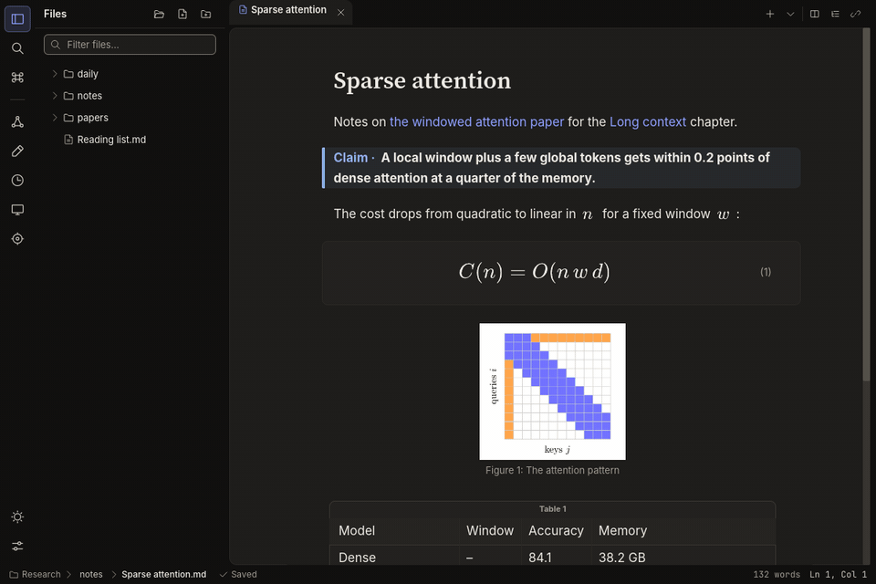
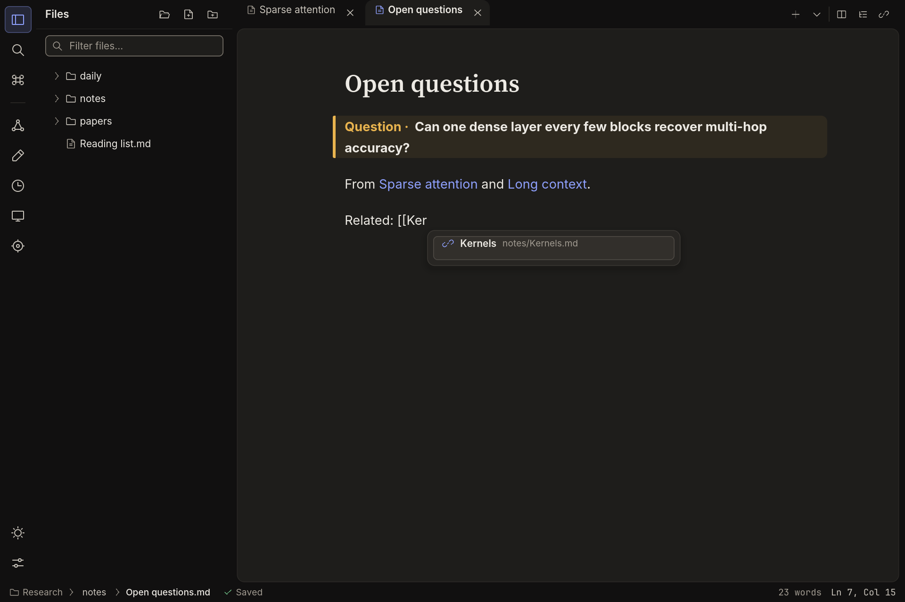
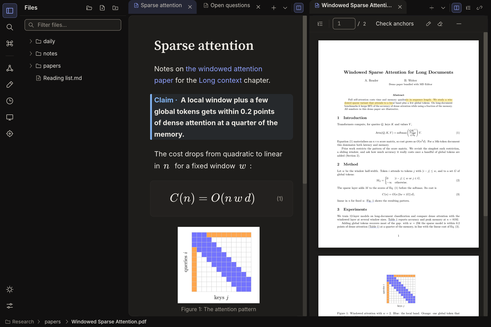
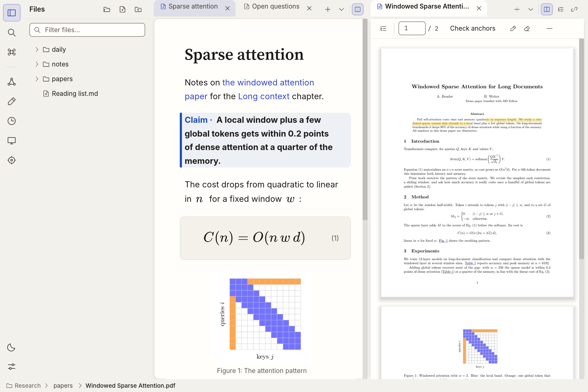
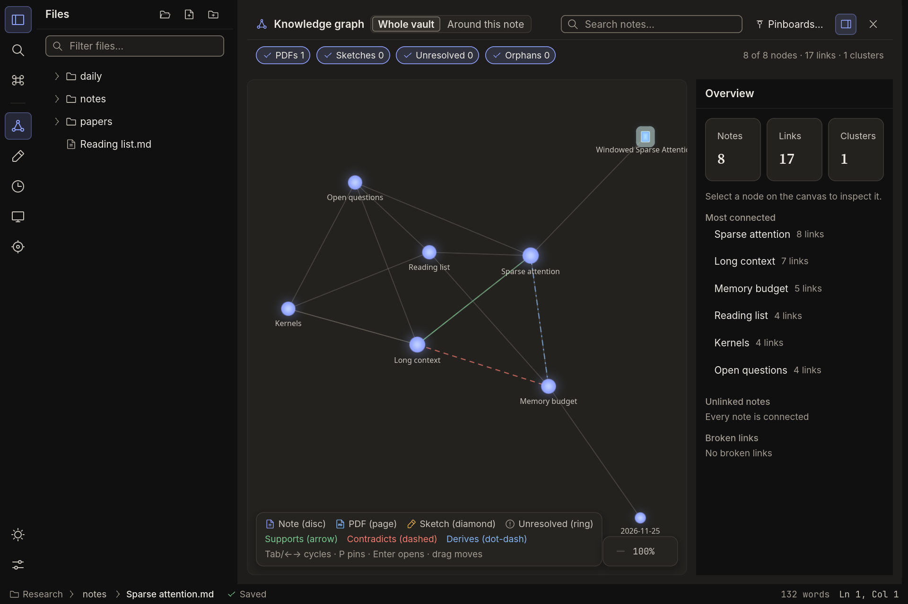
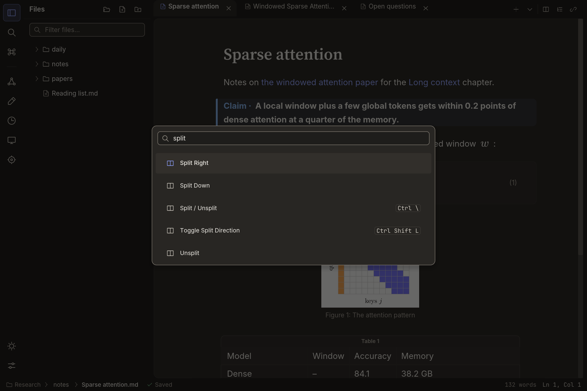
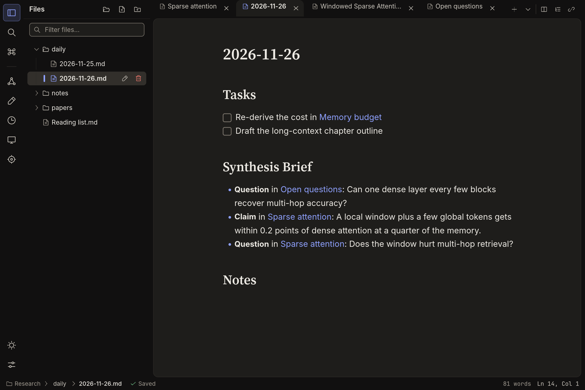
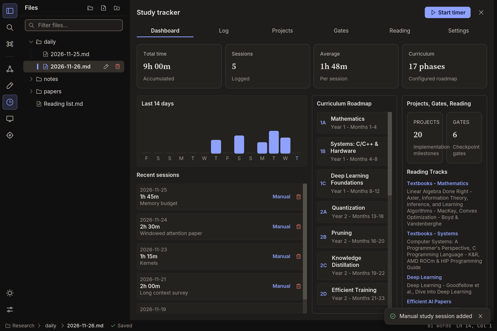

# MD Editor

**A local-first desk for research: Markdown notes, PDFs, a knowledge graph, handwriting and
study tracking, in one native app, on plain files.**



Open a folder and it becomes your vault. Write in Markdown with a live preview, read papers
beside your notes, pull a figure from a PDF into a note, sketch with a pen, and see how
everything links together. Your work stays as ordinary `.md`, `.pdf`, image and `.ink.svg`
files that other tools can open. There are no accounts and no telemetry.

MD Editor is written in Rust ([Iced](https://github.com/iced-rs/iced) and Google's
[PDFium](https://pdfium.googlesource.com/pdfium/)) and runs on Arch Linux.

---

## Write


- **Live preview that stays editable.** Markdown markers hide everywhere except the line
  you are on, so you always edit the real source.
- **Research Markdown.** Headings, emphasis, ~~strikethrough~~, tasks, tables, code with
  syntax highlighting, numbered `$$` math, YAML frontmatter, and callouts such as
  `> [!claim]`, `> [!question]` and `> [!output]`.
- **Live PDF crops.** Alt-drag over a figure or equation in a PDF, and a line like
  `` shows that part of the page
  in your note. It is rendered from the PDF each time, with no image file to keep.
- **Sketches in notes.** `Ctrl+Shift+I` starts a handwritten sketch at the caret; it shows
  inline and opens in the pen canvas.
- **Completion.** `[[` completes notes and their headings, `@` completes citations from
  `.bib` files and the PDFs in your vault, and `/` at the start of a line inserts callouts,
  tables, math and code blocks.
- **Editing keys you already know.** Word jumps and word deletes, `PageUp`/`PageDown`,
  `Tab`/`Shift+Tab` on selected lines, double-click to select a word, triple-click a line,
  word-sized undo, find and replace with regex.
- **Paste or drop images.** Screenshots and image files are stored in the vault and linked
  for you.
- **Calculate and run.** `Ctrl+=` evaluates the math under the caret. `Ctrl+Alt+R` runs a
  `sh` or `python` code block and writes its output below it. Nothing runs unless you
  ask, and it is **not sandboxed**: the code runs with your permissions.
- **Safe saving.** Notes save 400 ms after you stop typing, with atomic writes that keep
  permissions and symlinks. If another program changed the file meanwhile, its version is
  kept as a conflict copy instead of being overwritten.



## Read



- **Two panes, any mix.** Note + PDF, note + note or PDF + PDF, side by side or stacked
  (`Ctrl+\`). Each pane has its own tabs, and *Save Desk* keeps a layout to come back to.
- **A PDF reader for papers.** Continuous scrolling that stays fast on 500-page books, an
  outline even for PDFs without bookmarks (rebuilt from the contents page or the
  headings), and previews of "Eq. (3)", "Fig. 2", "Table 1" or "§3.2" when you right-click
  them.
- **Highlights that travel with the vault.** Highlights, quick notes and margin ink never
  change the PDF. They live in SQLite and in `.jsonl` files under `<vault>/.md-editor/`, so
  syncing the vault with Git or Syncthing brings them along.
- **Linked notes.** Send a highlight to a note as a quoted section with a `pdf://` link
  back to that exact spot.
- **Search inside the PDF**, including a loose mode that matches across line breaks and
  hyphenation.

| Light theme | |
| --- | --- |
|  | Dark and light themes, interface scale, reading font, text size and line width are in Settings (`Ctrl+,`). The whole app works from the keyboard; `F6` moves between regions. |

## Connect



- **Knowledge graph** (`Ctrl+G`) of notes, PDFs and sketches, drawn on the GPU, for the
  whole vault or around the open note.
- **Typed links.** Write `supports:: [[Claim]]`, `contradicts:: [[Paper]]` or
  `derives:: [[Equation]]` in a note and the graph draws an arrow, a dashed line or a
  dot-dash line. Node shapes show what each node is: disc for a note, page for a PDF,
  diamond for a sketch, ring for a missing link.
- **Pinboards.** Pin nodes where you want them and save the arrangement by name.
- **Backlinks and outline** beside the note; bare `[[Name]]` links find notes in any
  subfolder, and renaming a note or folder fixes the links to it.

## Find



- `Ctrl+P`: one palette for commands and files.
- `Ctrl+Shift+F`: search the whole vault, PDF text and your PDF notes included, with
  matches in file names ranked higher. Choosing a result opens it at the match.
- `Ctrl+F`: find in the note or PDF you are looking at.

## Keep going

| Daily Desk | Study tracker |
| --- | --- |
|  |  |

- **Daily Desk** (`Ctrl+D`) opens `daily/YYYY-MM-DD.md`. A new day starts with yesterday's
  unchecked tasks, a brief of open `[!question]` and `[!claim]` callouts from your notes,
  and what you studied last.
- **Study tracker** (`Ctrl+T`). A timed session records which notes, PDFs and sketches you
  worked on, pages read, words written and highlights made. The tracker also keeps your
  reading, projects and checkpoint gates. It ships with a sample curriculum, which you
  replace with your own in its JSON config.

## Write by hand

`Ctrl+I` opens a pen canvas in its own window, for a tablet or a second screen. Pen
pressure works on Wayland. You get pen, highlighter, eraser and lasso
tools, ruled, grid or dotted paper, and a ring menu on the pen's side button. Pages save as
`.ink.svg`: browsers and GitHub show them as ordinary SVG, and MD Editor reopens them with
every stroke editable.

---

## Your files, your machine

- The vault is a normal folder; MD Editor never moves or converts your files.
- Settings, window layout, PDF text caches and the search index live in one SQLite file,
  `~/.local/share/md-editor/md_editor_settings.sqlite` (`$XDG_DATA_HOME` is respected); the
  log is `~/.local/state/md-editor/md-editor.log`. `MD_EDITOR_DATA_DIR` points both at
  another folder.
- PDF highlights and study sessions are also written to `<vault>/.md-editor/` so that they
  sync with the vault.
- Nothing is sent anywhere.

## Supported files

| Type | Extensions |
| --- | --- |
| Markdown | `.md`, `.markdown` |
| PDF | `.pdf` |
| Images | `.png`, `.jpg`, `.jpeg`, `.gif`, `.bmp`, `.svg`, `.webp` |
| Handwritten pages | `.ink.svg` (and older `.ink`) |
| Citations | `.bib` (read for `@` completion) |

Indexing skips `node_modules`, `target`, `build`, `dist`, `__pycache__`, `.trash`, every
dot-folder, and any folders you exclude in Settings.

## Documentation

- [User Guide](wiki/User-Guide-and-Feature-Manual.md) and
  [Keyboard Shortcuts](wiki/Keyboard-Shortcuts.md)
- [Developer wiki](wiki/Home.md): architecture, data flows, testing, and where to change
  what
- [Open items](docs/open-items.md): what is not finished yet

## Install

Build and install the Arch package from a checkout (`packaging/arch/`):

```bash
scripts/build-arch-package.sh -si   # builds target/arch-package/*.pkg.tar.zst and installs it
```

The same PKGBUILDs (`md-editor-git` for the latest `main`, `md-editor` for tagged releases)
are ready for the AUR but not published there yet.

The package installs `/usr/bin/md-editor`, PDFium at `/usr/lib/md-editor/libpdfium.so`, a
desktop entry (MD Editor opens Markdown and PDF files from the file manager) and
icons. `pacman -R md-editor-git` removes them and keeps your data.

## Build From Source

### Requirements

- Rust stable 1.85+ with Cargo (2024 edition)
- A C compiler, for the bundled SQLite
- A desktop environment capable of creating native windows
- Internet access on the first build, if PDFium is not already cached

### Run In Development

```bash
cargo run
```

### Build A Release Binary

```bash
cargo build --release
```

The binary is `target/release/md-editor`. The PDFium library is copied next to it during the
build, where development builds find it. The download is pinned to a tested release and
checksum-verified; `PDFIUM_RELEASE` and `PDFIUM_SHA256` override it, and `PDFIUM_ARCHIVE`
points the build at an already-downloaded archive (the PKGBUILD uses it).

At runtime PDFium is looked up in `<exe>/../lib/md-editor/` (the installed layout), then
beside the executable and in `<exe>/resources/`, then on the system library path.

## License

MD Editor is released under the **GNU General Public License v3.0 or later** (`GPL-3.0-or-later`).
See [LICENSE](LICENSE) for the full text.
