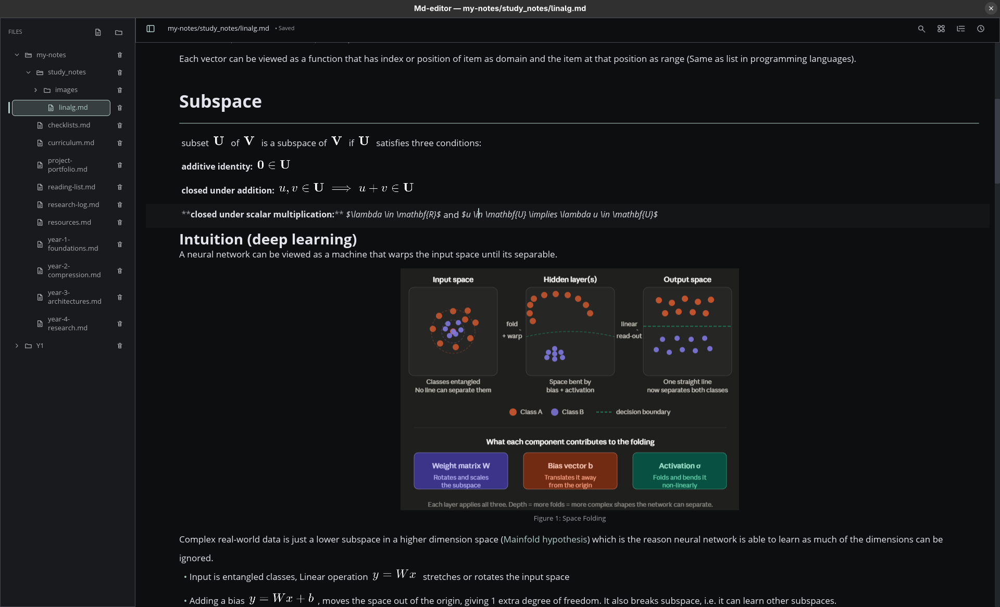
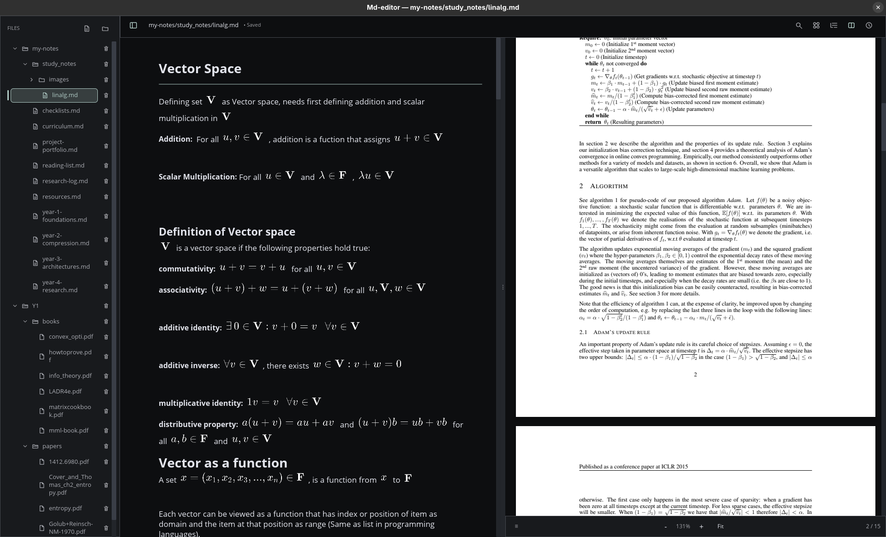
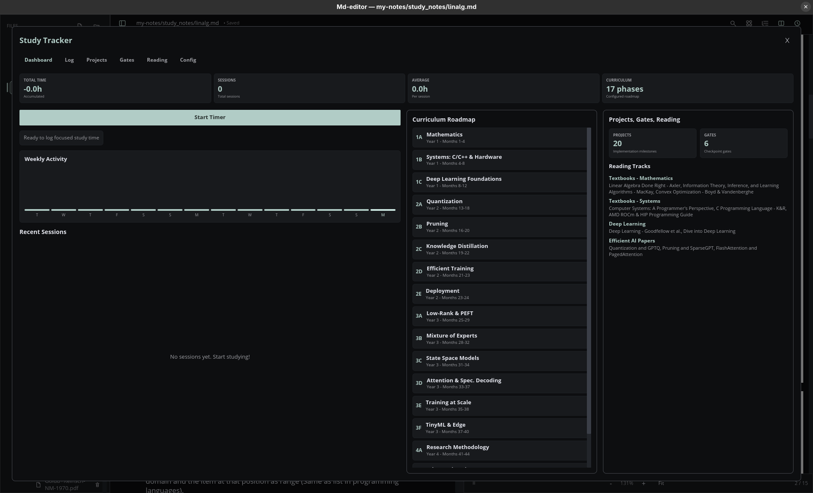

# MD Editor

**A calm, local-first Markdown workspace for notes, PDFs, presentations, knowledge graphs, handwriting, search, backlinks, and study progress.**


MD Editor is a native desktop app for people who do serious work with ordinary files. Open a
folder as your vault, write in Markdown, read PDFs beside your notes, keep track of study
sessions, and search across everything without moving your thinking into a cloud-only system.

It is designed to feel personal and practical: a desk for your notes, papers, references, and
progress, all stored locally in formats you can keep using outside the app.

---

## At A Glance

| Work locally | Read deeply | Find quickly | Keep momentum |
| --- | --- | --- | --- |
| Use any folder as a vault. Your Markdown, PDFs, and images stay as normal files. | Open PDFs beside notes, copy text, create sidecar highlights, and link important passages back to Markdown. | Search the active file, the whole vault, and PDF text, or explore their connections in the knowledge graph. | Track sessions, reading, project stages, and study gates in the same workspace. |

## Why It Exists

Most writing tools are either too small for research or too eager to own your workflow.
MD Editor takes a quieter route.

You bring a folder. The app gives you a native workspace around it: an editor, file tree,
backlinks, knowledge graph, table of contents, PDF viewer, search tools, image preview, and
study tracker. When you close the app, your work is still there as plain Markdown and local files.

Use it for:

- research notes and reading logs;
- study vaults and course material;
- project journals and technical documentation;
- paper review, PDF annotation, and linked notes;
- any long-running body of notes that should remain portable.

## The Workspace

### 1. Open A Vault

Choose a folder and MD Editor turns it into a working vault. The sidebar indexes supported
files and gives you a familiar tree for opening, creating, and deleting notes. Indexing skips
`node_modules`, `target`, `build`, `dist`, `__pycache__`, `.trash`, and every dotfolder, so
`.git` stays out of the way, along with any folders you add in Settings. A filesystem
watcher picks up changes made outside the app.

Every note, PDF, deck and image opens in a tab that remembers its place — caret and undo
history, page and zoom — and the tabs come back the next time you open the vault. Dark and
light themes, the interface scale, the reading font, text size and line width are in
Settings (`Ctrl+,`); the whole app is usable from the keyboard (`F6` moves between regions).

### 2. Write In Markdown

- Hybrid live preview: markers hide when the cursor is elsewhere and reappear on the line
  you are editing, so you always edit real source.
- Headings, emphasis, links, blockquotes, task checkboxes, tables, images, and math.
- Paste a screenshot, paste or drop image files, or use Insert image…: they are stored as
  attachments in the vault and linked from the note.
- Fenced code blocks with syntax highlighting.
- Wide tables and code blocks scroll horizontally on their own.
- In-file find with regex and match case, replace one at a time or all at once.
- Auto-pairing of brackets and quotes, with contraction apostrophes left alone.
- List continuation, including numbered lists that increment.
- Undo grouped into word-sized runs, preserved when you switch between notes.
- Table of contents navigation, and backlinks for discovering connected material — bare
  `[[Name]]` links resolve across subfolders by filename.
- Autosave 400ms after typing stops, with atomic writes: a crash cannot truncate a note, and
  existing permissions and symlinks are preserved.

### 3. Explore The Knowledge Graph

Open the Knowledge Graph from the toolbar, the command palette, or with
`Ctrl+G`. Global view maps the vault's notes and PDFs; Local view follows the
active note or PDF by one or two hops. Markdown notes, PDFs, and unresolved
targets are shown as distinct nodes, while both wikilinks and links created from
PDF annotations become connections.

Pan and zoom the canvas, drag notes into place for the current session, select a
node to inspect its incoming and outgoing links, or open it directly. Search and
filters can narrow the graph to useful material, while related-note suggestions
and vault-health summaries reveal unconnected notes, broken links, and highly
connected hubs.

Graph connections reflect the saved vault, so new wikilinks appear after save.

### 4. Keep References Beside Your Notes

PDFs open inside the app, so reading and writing happen in one place.

- Continuous page rendering, fit-to-width, and zoom, supersampled so pages stay sharp in a
  narrow split pane and on HiDPI displays.
- A PDF table of contents, recovered from the document itself when there are no embedded
  bookmarks — from a printed contents page, its dot leaders, or a typographic heuristic.
- Internal PDF links, plus recognition of by-number cross-references (equations, figures,
  tables, sections) that you can right-click to preview in place.
- Text selection and copy.
- PDF search with highlighted matches, including a loose mode that matches across line breaks.
- Sidecar highlights with auto-cycling colours, quick notes, and an orphan/drift report.
- Linked Markdown notes with a `pdf://` deep link back to the exact page and highlight.

PDF highlights and recognized references are stored separately, so the original PDF is never
modified.

PowerPoint decks (`.pptx`) open in a read-only slide viewer: every slide in one scrolling
column, with slide-by-slide navigation and zoom. Slides are drawn natively — no Office or
LibreOffice install is needed — including theme colours, placeholders inherited from layouts
and masters, tables, pictures, and grouped shapes. Charts, SmartArt, and embedded objects
show as labelled boxes.

### 5. Write By Hand

`Ctrl+I` opens a handwriting canvas in its own window, ready for a tablet or a second
monitor. On Windows, pen pressure shapes every stroke; elsewhere it works with a mouse. Pen,
highlighter, eraser and lasso tools, ruled, grid or dotted paper, and a ring menu summoned
with the pen's barrel button. Pages save as `.ink` files beside the note you are working on.

### 6. Search Without Breaking Flow

- `Ctrl+F` in Markdown searches the active note.
- Global search scans the vault and indexed PDF text through SQLite FTS5.
- `Ctrl+F` in the PDF pane searches the active PDF.
- In split view, `Ctrl+F` follows whichever pane you last touched.
- `Ctrl+P` opens a command palette that searches commands and vault files together.

### 7. Track Study Progress

A built-in tracker records sessions, reading, project stages, and checkpoint gates. It ships
seeded with a four-year efficient-ML research roadmap, which you replace with your own
through a JSON config tab — the tracker itself only knows about phases, projects, gates, and
reading sections.

## Screenshots

### Markdown Editing



### Notes And PDFs Together



### Study Tracker



## A Local-First Promise

MD Editor does not hide your work inside a proprietary database.

- Your vault is a normal folder.
- Notes are normal Markdown files.
- PDFs and images stay where you put them.
- Settings and app state live in one SQLite file under `~/.local/share/md-editor/`.
- Nothing is sent
  anywhere — no accounts, no telemetry.

The app creates a single SQLite file:

```text
md_editor_settings.sqlite
```

It lives in `~/.local/share/md-editor/` (`$XDG_DATA_HOME/md-editor/` when set). The log,
`md-editor.log`, is in `~/.local/state/md-editor/`. A database left beside the executable by
an older portable build is copied there on first run; the original is left in place.
`MD_EDITOR_DATA_DIR` points both at another folder (a throwaway profile, for example).

## Supported Files

| Type | Extensions |
| --- | --- |
| Markdown | `.md`, `.markdown` |
| PDF | `.pdf` |
| Images | `.png`, `.jpg`, `.jpeg`, `.gif`, `.bmp`, `.svg`, `.webp`, `.avif` |
| Presentations | `.pptx` (view only) |
| Handwritten pages | `.ink` |

## Supported Platforms

MD Editor targets **Arch Linux** (x86_64), on Wayland or X11. Other platforms are not
supported for now.

## Install

From the AUR, with any AUR helper:

```bash
yay -S md-editor-git     # latest main
yay -S md-editor         # tagged releases
```

Or build the package from a checkout (`packaging/arch/`):

```bash
scripts/build-arch-package.sh -si   # builds target/arch-package/*.pkg.tar.zst and installs it
```

The package installs `/usr/bin/md-editor`, PDFium at `/usr/lib/md-editor/libpdfium.so`, a
desktop entry (MD Editor opens Markdown, PDF and PowerPoint files from the file manager) and
icons. `pacman -R md-editor-git` removes them and keeps your data.

## Build From Source

### Requirements

- Rust stable 1.85+ with Cargo (2024 edition)
- A C compiler, for the bundled SQLite
- A desktop environment capable of creating native windows
- Internet access on the first build, if PDFium is not already cached

### Run In Development

```bash
cargo run
```

### Build A Release Binary

```bash
cargo build --release
```

The binary is `target/release/md-editor`. The PDFium library is copied next to it during the
build, where development builds find it. The download is pinned to a tested release and
checksum-verified; `PDFIUM_RELEASE` and `PDFIUM_SHA256` override it, and `PDFIUM_ARCHIVE`
points the build at an already-downloaded archive (the PKGBUILD uses it).

At runtime PDFium is looked up in `<exe>/../lib/md-editor/` (the installed layout), then
beside the executable and in `<exe>/resources/`, then on the system library path.

## License

MD Editor is released under the **GNU General Public License v3.0 or later** (`GPL-3.0-or-later`).
See [LICENSE](LICENSE) for the full text.
