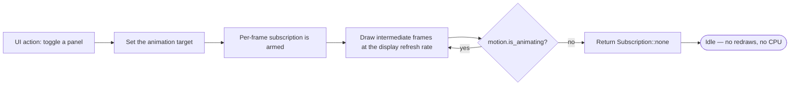

# Design System, Motion & Command Palette

MD Editor gets its polish from three small, strict systems: a design system that leaves no
room for arbitrary numbers or colours, a motion vocabulary of one curve and three durations,
and a fuzzy matcher whose scores are comparable across commands and files.

---

## 1. Design system (`native/src/design/`, `native/src/ui/`)

The specification is [`docs/design-system/md-editor/MASTER.md`](../docs/design-system/md-editor/MASTER.md)
with per-surface overrides in `pages/` (editor, viewers, graph, ink, tracker). The code:

| Module | Holds |
| :--- | :--- |
| `design/palette.rs` | `Tokens`: the semantic colour roles (`bg.*`, `fg.*`, `border.*`, `accent`, `status.*`, `doc.*`, `viewer_ground`) as two tables, `DARK` and `LIGHT`; `ContentHue`, the user-content palette (highlight colours) that does not change with the theme; `fade()` |
| `design/type_scale.rs` | `TextRole` (`Caption`, `Label`, `Body`, `BodyStrong`, `TitleSm`, `Title`, `Heading`, `Display`, `Mono*`): size, line height and font per role, scaled by the interface scale, never below 12px |
| `design/metrics.rs` | The 4px spacing grid `SPACE_0` … `SPACE_7`, control and icon sizes, radii, `Elevation` shadows, toolbar/tab/status heights, panel default widths and drag limits, dialog widths |
| `design/fonts.rs` | The bundled faces: Inter (UI and sans reading), JetBrains Mono (code, figures), Source Serif (serif reading) |
| `design/motion.rs` | Durations, easing, reduced motion, the panel `Motion` state and `Spring` (section 2) |
| `design/mod.rs` | The runtime settings: theme mode and active theme (`tokens()` returns the active table), interface scale, reading font, editor font size, line width, and `theme_revision()`, which caches fold in so a change repaints everything |
| `design/setting.rs` | `Setting`: those values are process-wide in the app and per-thread under `cargo test`, so tests that switch theme or size do not disturb each other |
| `ui/` | The components (`Button`, `IconButton`, `TextField`, `Segmented`, `Toggle`, `Menu`, `Dialog`, `Toast`, `Panel`, `TabStrip`, `StatusBar`, `TreeRow`, `ListRow`, …), built only from the above. `ui/gallery.rs` renders every one in both themes at 90/100/130% |

Rules, enforced by tests in `design/tests.rs`: every documented foreground/background pair
meets WCAG contrast in both themes; no UI role is below 12px; `ui/` has no colour or motion
literals, and `views/` and `app/` have no colour literals.

Two rules about colour:

- **Chrome follows the theme, content does not.** Highlight colours on a PDF page, ink on
  the handwriting paper and the content of slides keep their colours in both themes.
- **Never colour alone.** Selection, status and kinds always pair the colour with an icon,
  a label, a filled glyph or an outline (the active find match has an outline; graph kinds
  have icons in the legend and inspector).

The editor reads its typography from the same settings: `editor/renderer/metrics.rs`
scales the highlighter's sizes to the chosen body size (`scaled`), caps the column at the
chosen line width (`max_content_width`), and `measure::body_font` picks Inter or Source
Serif.

---

## 2. Motion (`native/src/design/motion.rs`)

Before this module the app had no motion at all: panels appeared and vanished between one
frame and the next. Nothing is *missing* from a snapshot of an instant UI — it just feels
abrupt, because the eye gets no continuity between the two states.

The vocabulary is deliberately small, for the same reason the type and spacing scales are.

### One easing curve

```rust
pub const EASE: Easing = Easing::EaseOutQuad;
```

Decelerating motion reads as a thing coming to rest, which is what opening a panel or
landing a toast is. Symmetric or accelerating curves read as mechanical by comparison.

### Three durations

```
FAST (100ms) ─── small, frequent transitions: a toast arriving, a chip changing state
BASE (160ms) ─── layout-level transitions: a side panel opening or closing
SLOW (220ms) ─── overlays that cover the workspace: the command palette
```

Exits run at 65% of their entry (`exit_duration`). Everything goes through `duration()`,
which returns zero under reduced motion (Settings → Appearance, defaulting to the OS
preference).

### Panel widths

A panel's open width must match the width it actually lays out at, or the clip that produces
the slide crops it permanently. Widths are the user's (drag the split handles; double-click
resets to `SIDEBAR_DEFAULT_WIDTH` / `SIDE_PANEL_DEFAULT_WIDTH`), so `MdEditor::update` copies
them into `Motion`'s `*_target_width` before each sync.

### The `Motion` struct

`Motion` holds an `iced::Animation<bool>` mirroring each visibility flag — `sidebar`, `toc`,
`backlinks`, `toast`, `palette` — plus:

- `now: Instant`, the timestamp the current frame is drawn for. `view` reads *this* rather
  than calling `Instant::now()` itself, so every animation in a frame is sampled at the same
  instant;
- `toast_text: String`, retained after `ui.toast` clears so the toast has something to draw
  while it fades out;
- `editor_scroll: Option<ScrollGlide>`, the editor gliding to reveal the caret, while it is.

The booleans themselves stay where they live (sidebar visibility on the vault state, TOC on
the editor pane); `Motion` only tracks how far each has travelled.

### Springs

Transitions between two known states ease over a duration. Motion that *follows* something
— the page scrolling to a caret that keeps moving as you type — uses a critically damped
spring instead, because its target can change mid-flight:

```rust
pub struct Spring { target, x0, v0, start, stiffness }
// x(t) = target + (x0 + (v0 + ω·x0)·t)·e^(−ωt)
```

The spring is **solved in closed form**, not integrated frame by frame, so it traces the
same curve at 30Hz or 240Hz and a dropped frame costs nothing. Critical damping is the
fastest approach that doesn't overshoot from rest. `retarget` keeps position and velocity,
so a new target bends the path instead of kinking it; `shift` displaces it while keeping
velocity; `is_settled` holds once distance plus momentum is below a tenth of a pixel.

```
SCROLL_STIFFNESS 32   ─── the editor scrolling to reveal the caret: ~150ms to 95%
GLIDE_STIFFNESS  80   ─── the caret gliding to its new place: ~60ms to 95% (renderer/glide.rs)
```

### The caret

The caret is lit for 500ms after it moves, then blinks with a soft fade — a cosine over
1060ms, stretched and clamped so it holds fully on and fully off with quick fades between —
and stays lit after 18 blinks. See [Markdown Pipeline](Markdown-Pipeline.md#caret-motion-gliders).

### Zero idle CPU



The per-frame redraw subscription is armed **strictly** while `motion.is_animating()` holds.
The moment every transition settles it returns `Subscription::none()`, and the process goes
back to sleep until the next user event. This is one of the five
[durability invariants](Data-Flows-and-Durability-Invariants.md) and is verified before every
release.

The editor widget schedules its own frames by the same rule: `shell.request_redraw()` only
while the caret glides or fades, `request_redraw_at` for the instant the next fade begins,
and nothing once the caret rests lit.

---

## 3. Fuzzy Matcher & Command Palette

`Ctrl+P` opens a palette that searches commands and vault files **together**. The query field
takes focus the moment it opens, so the palette is reachable without the mouse.

### Ranking heuristics (`native/src/fuzzy.rs`)

```rust
pub fn score(haystack: &str, query: &str) -> Option<i32>
pub fn score_path(path: &str, query: &str) -> Option<i32>
```

`score` walks the query left to right, advancing through the haystack to each next matching
character (case-insensitively). `None` means the query does not appear in order at all.

| Rule | Effect |
| :--- | :--- |
| Base | `+10` per matched character |
| **Word start** | `+18` when the character is at index 0 or follows a boundary — `space / \ - _ . ( [` |
| **CamelCase** | `+10` when it is an uppercase letter inside a word (mutually exclusive with the word-start bonus) |
| **Adjacency** | `+12` when it directly follows the previous match, rewarding runs |
| **Distance penalty** | `-min(gap, 8)` for the characters skipped since the previous match |
| **Length normalization** | `-(haystack.len() / 12)` overall, preferring the tighter of two otherwise-equal matches |

`score_path` scores the whole path *and* the filename alone — the latter with a **`+24`**
bonus — and takes the better of the two. Typing `note` surfaces `note.md` before
`notes/archive/something-else.md`.

Concretely: `tocfg` finds *Tracker Configuration*, and `sv` ranks *Split View* first on
initials alone.

### The command registry (`views/command_palette.rs`)

Every action the palette can run is declared in **one** registry, so a command exists in
exactly one place and the palette and the shortcut list cannot drift apart:

| Command | `Shortcut` |
| :--- | :--- |
| New File | `NewFile` |
| Open Vault | `OpenVault` |
| Save File | `Save` |
| Search Vault | `Search` |
| Toggle Sidebar | `ToggleSidebar` |
| Toggle Backlinks | `ToggleBacklinks` |
| Table of Contents | `TableOfContents` |
| Study Tracker | `StudyTracker` |
| Split View | `SplitView` |
| Focus Mode | `FocusMode` |

*Toggle Backlinks*, *Study Tracker*, *Split View*, and *Focus Mode* have **no direct key
binding** — the palette is how you reach them.

### Ranking and interleaving

- With an **empty query** the palette is a menu of what the app can do: commands only, since
  files would just be an arbitrary slice of the vault.
- With a query, commands are scored with `fuzzy::score` and files with `fuzzy::score_path`,
  on the same numeric scale, then **interleaved by relevance** rather than split into fixed
  sections.
- Commands get **`+8`** at equal relevance: the palette is primarily a way to *act*, and a
  file is one keystroke away in the sidebar anyway.
- Directories are never offered as results.
- The list is capped at `MAX_RESULTS = 40` — past that the answer is a longer query, not more
  scrolling.
- `Up`/`Down` move the highlighted row, `Enter` activates it, `Escape` closes. A file opens
  in the right viewer for its type; changing the query resets the highlight to the first row,
  since keeping the old index would leave it on an unrelated result.

The palette's ranking is covered by eight unit tests, including that `Enter` activates
exactly the highlighted row and that `result_count` matches what is rendered.
