# Developer Guide & Testing

Setting up the toolchain, building the workspace, resolving PDFium, running the tests, and
installing the Linux desktop entry.

---

## 1. Prerequisites

MD Editor targets the **Rust 2024 edition**.

- **Rust toolchain** — stable Rust 1.85 or newer (2024 edition), with Cargo.
- **C compiler** — `gcc` or `clang`, needed to build the bundled SQLite that `rusqlite`
  compiles from source.
- **A desktop environment** capable of creating native windows, to *run* the app. The core
  crate's tests need none.
- **Network access on the first build**, so `core/build_pdfium.rs` can fetch PDFium. Later
  builds reuse the cache under `target/pdfium/`.

### Linux packages

Debian / Ubuntu:

```bash
sudo apt update
sudo apt install -y build-essential pkg-config libxkbcommon-dev libfontconfig1-dev
# Wayland / X11 windowing
sudo apt install -y libwayland-dev libx11-dev
```

Arch:

```bash
sudo pacman -S --needed base-devel pkgconf libxkbcommon fontconfig
```

---

## 2. Build & Run

All commands run from the repository root.

```bash
cargo fmt --check            # formatting
cargo check --workspace      # fast typecheck
scripts/clippy-ratchet.sh    # lints — see the note below
cargo test --workspace       # full test suite
cargo run                    # launch in debug
cargo build --release        # optimized binary
```

> `cargo fmt --check`, `cargo test --workspace` and clippy are all clean: the baseline in
> `clippy-baseline.txt` is 0. `scripts/clippy-ratchet.sh` fails if the count rises above it.
> View builders with many inputs take a `…Props` struct (`ToolbarProps`, `SearchProps`,
> `TrackerProps`, `ContinuousProps`) rather than positional arguments.
>
> Lint policy lives in `[workspace.lints]` in `Cargo.toml` and `clippy.toml` (tests may
> unwrap and print). Core forbids `unsafe` and warns on `unwrap()`; so does `native/src/app/`.
> `print!`/`eprintln!` are linted everywhere except the CLI installer and the examples — use
> `log::{info, warn, error}` instead (see *Logging* below). The Win32 modules deny
> undocumented `unsafe` blocks.

### Logging

`native/src/logging.rs` installs a `log` logger at startup. Records go to `md-editor.log` in
the data directory (beside the settings database), rotated at 1 MB with three old files
kept (`.1`–`.3`); warnings and errors are echoed to stderr. `MD_EDITOR_LOG` is a
comma-separated list: a bare level for the app's own crates (`error`, `warn`, `info` — the
default — `debug`, `trace`, `off`) and `target=level` overrides matched by module-path
prefix, e.g. `debug,iced_winit=info`. Other crates default to `warn` (iced_winit logs each
window's icon pixels at `info`). Lines over 8 KB are truncated, and a run of identical
messages is written once plus a "repeated N more times" line. A panic hook logs the
panic with a backtrace before the default hook runs. Core logs through the same facade.

Release output:

| Platform | Executable |
| :--- | :--- |
| Linux / macOS | `target/release/md-editor` |
| Windows | `target\release\md-editor.exe` |

The PDFium shared library is copied next to the binary, into the same Cargo profile
directory, by the build script.

### Running with a file

The binary accepts a single path argument — a file or a directory — which is how the Linux
desktop entry's `Exec=... %F` hands documents to the app:

```bash
./target/release/md-editor ~/vault/Summary.md
```

---

## 3. PDFium Resolution

### Build time (`core/build_pdfium.rs`)

The script picks a platform slug from `CARGO_CFG_TARGET_OS` and `CARGO_CFG_TARGET_ARCH`,
downloads the matching archive from
[`bblanchon/pdfium-binaries`](https://github.com/bblanchon/pdfium-binaries), extracts it, and
copies the library both into `core/pdfium/` and into the Cargo profile output directory.

| Platform | Architecture | Slug | Library |
| :--- | :--- | :--- | :--- |
| Linux | `x86_64` / `aarch64` | `linux-x64` / `linux-arm64` | `libpdfium.so` |
| Windows | `x86_64` / `aarch64` | `win-x64` / `win-arm64` | `pdfium.dll` |
| macOS | `x86_64` / `aarch64` | `mac-x64` / `mac-arm64` | `libpdfium.dylib` |

An unsupported platform prints a warning and skips the download; PDF support is then simply
unavailable and the rest of the app still builds.

By default the build downloads a **pinned** release (`DEFAULT_PDFIUM_RELEASE` in
`core/build_pdfium.rs`, currently `chromium/8165`) and verifies it against the per-platform
SHA-256 in `pinned_sha256`; a mismatch **panics** the build. To move the pin, update both
together. Two environment variables override it:

| Variable | Effect |
| :--- | :--- |
| `PDFIUM_RELEASE` | Use another release tag, for example `chromium/6996` or `latest`. |
| `PDFIUM_SHA256` | Expected hex digest of the platform `.tgz` for an override. When set, a mismatch panics the build; when unset on an override, the script warns that the archive is unverified. |

The archive is cached at `target/pdfium/<slug>/`, so a rebuild with the library already
present skips the network entirely.

### Runtime (`core/src/pdf.rs::bind_pdfium`)

The binding is created **once per process** behind a `OnceLock`, and candidates are tried in
this order:

1. `<executable directory>/../lib/md-editor/<library>` — the installed layout
   (`/usr/bin/md-editor` + `/usr/lib/md-editor/libpdfium.so`)
2. `<executable directory>/<library>` — development builds
3. `<executable directory>/resources/<library>`
4. `<CARGO_MANIFEST_DIR>/pdfium/<library>` — tests run from the source tree
5. the plain library name, leaving resolution to the system loader

The list is built by `core/src/pdf.rs::pdfium_candidates`.

---

## 4. Testing

```bash
cargo test --workspace
```

The suite covers both crates, plus a few opt-in renderer tools that are
`#[ignore]`d by default (below). They run in a few seconds
and need no display server.

```mermaid
graph TD
    Runner["cargo test --workspace"] --> CoreTests["md-editor-core"]
    Runner --> NativeTests["md-editor-native"]

    CoreTests --> VaultT["vault/tests.rs — atomic writes, symlinks, permissions, exclusions"]
    CoreTests --> PdfT["pdf/tests.rs — page count, text, search, TOC recovery"]
    CoreTests --> RefsT["references.rs — target maps, call-sites, precision rules"]
    CoreTests --> IndexT["file_index.rs — wikilink resolution and backlinks"]
    CoreTests --> Massive["massive_tests.rs — 8 combinatorial and stress suites"]

    NativeTests --> BufferT["editor/buffer.rs — undo runs, auto-pairing, graphemes, affinity"]
    NativeTests --> HighlightT["editor/highlight/tests.rs — concealing, fences, incremental = fresh"]
    NativeTests --> RendererT["editor/renderer/ — invariants, caret, hit testing, motion, painting"]
    NativeTests --> TreeT["editor/layout_tree.rs — exact prefix sums and find_line_at_y"]
    NativeTests --> MotionT["design/motion.rs — springs, panel widths, settling"]
    NativeTests --> FuzzyT["fuzzy.rs — ordering, word starts, initials"]
    NativeTests --> PaletteT["views/command_palette.rs — ranking, caps, activation"]
    NativeTests --> AppT["app/tests.rs — PDF page slots, offsets, note paths"]
    NativeTests --> MainT["main.rs — CLI parsing, window size, desktop install"]
```



### Notable suites

1. **Atomic write guarantees** (`core/src/vault.rs`) — content replacement leaves no `.tmp`
   files behind, permissions are preserved, a symlink is written *through*, and a truncated
   file is never left on disk.
2. **Combinatorial and stress** (`core/src/massive_tests.rs`) — eight suites covering
   wikilink variants, graph topologies, dynamic index fuzzing, settings upserts at volume,
   tracker session volume, recursive vault operations, FTS5 indexing and search, and the
   file rename/delete lifecycle.
3. **Buffer semantics** (`native/src/editor/buffer.rs`) — undo-run coalescing, bracket
   wrapping and skip-over, contraction apostrophes, list continuation including ordered-list
   increment and multibyte markers, grapheme-cluster movement and deletion (CRLF as one
   stop), caret affinity that lasts only until the next change, and a deterministic editing
   stress test that asserts the cursor and selection stay valid.
4. **Highlighter** (`native/src/editor/highlight.rs`) — nested markdown, unclosed fences,
   inline math, code highlighting preserving the full source text, equivalence with a
   reference implementation, and seeded edit scripts proving incremental highlighting equals
   highlighting from scratch.
5. **Fenwick invariants** (`native/src/editor/layout_tree.rs`) — prefix sums match brute-force
   sums exactly, and `find_line_at_y` is monotonic and correct at boundaries.
6. **Renderer geometry** (`native/src/editor/renderer/`) — line heights, margins and table
   gutters (`layout.rs`), visual down-movement through empty and wrapped lines (`caret.rs`),
   selection extraction (`selection.rs`), inline reveal rules (`spans.rs`), caption numbering
   (`draw/captions.rs`), the reveal policy (`reveal.rs`), and the caret's glide and blink
   schedule (`glide.rs`).
7. **Renderer behaviour** (`native/src/editor/renderer/tests.rs`) — driven only through the
   `Widget` API and checked against the draw calls and messages that come out: the caret sits
   on painted text at every column of wrapped lines, clicking where the caret is drawn puts it
   back there, clicking past a row's end keeps the caret on that row, a multi-line selection
   is one continuous shape that covers images, tables and equations whole, painting over them
   and under text, wide code, tables and equations show nothing outside their viewports at
   any scroll position, an equation rendering late reflows the layout, a reveal request is
   answered once with the caret's drawn place,
   short caret moves glide and long ones cut, layout is skipped exactly while its inputs are
   unchanged, links on wrapped rows are clickable, table headers and stripes, scrollbar thumbs
   follow the pointer with no dead zone, clicks in scrolled code hit the character under the
   pointer, and no widths from 40 to 260px panic.
8. **Renderer invariants** (`native/src/editor/renderer/properties.rs`) — see
   [Property suites](#property-suites).
9. **PDF page geometry** (`native/src/app/tests.rs`) — target offsets map back to the same page,
   blank pages reserve space, and placeholder slots scale with zoom.
10. **Platform integration** (`native/src/main.rs`) — CLI argument parsing, window-size
   round-tripping and rejection of nonsense values, and a full Linux desktop install and
   uninstall round-trip against a temporary `$HOME`.

### Property suites

The editor's geometry is pinned by invariants rather than by examples alone.
`native/src/editor/renderer/properties.rs` generates documents from a seed — every block
and inline kind, pathological nesting, CRLF, widths from 40 to 1400px — using the generator
shared with the highlighter's suite (`native/src/editor/test_docs.rs`). A failing case is
shrunk line by line and reported with its seed and a minimal document.

| Invariant | Test |
| :--- | :--- |
| I1 — the caret lies on painted glyphs of its row, on either side of a row break | `caret_lies_on_painted_glyphs` |
| I2 — hitting where the caret is drawn yields a position drawn at exactly the same place | `hit_testing_inverts_caret_placement` |
| I3 — caret positions advance in reading order | `caret_order_follows_logical_order` |
| I5 — rows tile a line; painted content stays inside its line box | `rows_tile_their_line_and_contain_their_items`, `painted_content_stays_inside_line_boxes` |
| I6 — cached and early-out layouts equal a cold layout through edits and caret moves | `cached_layout_equals_cold_layout` |
| I8 — the height tree, the widget height and the uncached model agree | `height_tree_agrees_with_line_visual_y` |
| I9 — up and down move exactly one visual row | `vertical_moves_step_one_visual_row` |
| I10 — no input panics | `arbitrary_input_never_panics` |
| I11 — scroll offsets stay in range and thumbs follow drags | `scrollbars_stay_in_bounds_and_follow_drags` |
| I12 — drawing touches only visible lines | `drawing_visits_only_visible_lines` |

```bash
cargo test -p md-editor-native properties                          # default case counts
RENDER_PROPERTY_CASES=3000 cargo test -p md-editor-native properties # before a renderer change lands
RENDER_PROPERTY_SEED=<seed> cargo test -p md-editor-native properties # replay a reported failure
HIGHLIGHT_PROPERTY_CASES=3000 cargo test -p md-editor-native highlight
```

### Timing report

An ignored test prints what frames cost on a 37,000-line document — cold layout, a full walk
with warm caches, an unchanged frame, and drawing one screen. Run it in a release build;
debug numbers mean nothing:

```bash
cargo test -p md-editor-native --release layout_timing -- --ignored --nocapture
```

### Render transcript harness

`native/src/editor/render_snapshot_tests.rs` is an opt-in test (`#[ignore]`, so
`cargo test` skips it) for changes to the editor renderer. It drives the `Editor` widget
purely through its `Widget` API — layout, draw, update, and mouse interaction — against a
document that exercises every block and inline kind, at three widths. It records every
quad, text run, and image the widget draws, every message it publishes, clipboard writes,
and mouse-cursor shapes, into a plain-text transcript. Drawing goes to a recording renderer
that borrows the real renderer's text measurement, so no window or GPU is needed.

```bash
# Before the change: write a baseline transcript
RENDER_SNAPSHOT=/tmp/render.txt RENDER_SNAPSHOT_WRITE=1 \
  cargo test -p md-editor-native render_snapshot -- --ignored

# After the change: compare (writes /tmp/render.txt.actual on mismatch)
RENDER_SNAPSHOT=/tmp/render.txt cargo test -p md-editor-native render_snapshot -- --ignored
diff /tmp/render.txt /tmp/render.txt.actual | less
```

- **For a refactor**, the comparison must pass. That is how the split of `renderer.rs` into
  `renderer/` was verified to change nothing.
- **For a visual fix**, the diff should contain the draw calls you meant to change, and
  nothing else.

The transcript is large (tens of MB) and pins current behaviour, including known bugs, so
keep it out of the repository.

### Render previews

`native/src/editor/render_preview.rs` renders a sample document — wrapped styled and plain
paragraphs, tasks, a quote, inline and block math, a code block, a table, an image — to PNG files
using iced's tiny-skia software renderer, so rendering can be looked at without opening a
window. Scenes cover a caret mid-paragraph, a caret after a checkbox, a selection across
wrapped rows, a selection across lines, a selection across a table, an equation and an
image, a caret in equation source, and a wide unfocused view. Equations are rendered by the
app's own `render_latex_task`, and the image is the repository's `md-editor.png`, so what
the previews show is what the app draws.

```bash
RENDER_PREVIEW_DIR=/tmp/previews cargo test -p md-editor-native render_preview -- --ignored
```

It uses only the widget's public API, so the same file can be dropped into an older
checkout to render a before/after pair. Text is shaped with system fonts, so glyphs the
software renderer's fonts lack (the task checkmark, for one) may show as boxes.

### Reference-resolver tools

```bash
cargo run --example dump_refs -- path/to/paper.pdf    # precision spot-check
cargo run --example bench_refs -- path/to/paper.pdf   # text-scan cost
```

### End-to-end scenarios (`native/src/e2e/`)

The real program runs headless in `iced_test`'s emulator on a throwaway vault, with a private
data directory (`test_support::isolate_data_dir`; every test that builds the app uses it).

- `scenarios.rs` — data safety: autosave/undo (S2), rename/delete of the open note (S4),
  tracker validation (S11), switching vault while dirty (S15), external edits (S16), failure
  injection (S17).
- `flows.rs` — UI flows: boot variants (S1), navigation (S3), search (S5), find/replace
  (S6), palette (S7), PDF (S8), split view (S9), graph (S10), handwriting (S12), scale (S13,
  `#[ignore]`d — run before releases), formatting (S14).
- `Session` drives the app: `send` (then settle), `send_quick` (no settle — edits stay
  unsaved), `type_in_note`, `click`, `wait`, `screenshot`, `probe()` (state after the last
  update), `restart` (relaunch keeping settings), `finish`.
- After every settle the **quiet-state invariants** run (`invariant_violations`): a clean
  note equals disk, the tree equals disk, no PDF page pending, no unexpected error toast
  (`expect_error_toast()` to allow one), no update over budget (100 ms default,
  `set_update_budget`). A failure names the step and saves a screenshot.
- Toasts auto-hide after 3 s; assert on them with `send_quick`, not after long waits.

```bash
cargo test -p md-editor-native e2e -- --nocapture       # ~90 s; screenshots + telemetry in target/e2e/
cargo test -p md-editor-native s13 -- --ignored          # the slow scale scenarios
```

### README screenshots and GIF

`scripts/readme-media.sh` regenerates everything in `images/`. It runs the `#[ignore]`d
scenario `e2e/showcase.rs::readme_media`, which builds a demo research vault (with the
paper `tests-fixtures/showcase/sparse-attention.pdf`, built from the `.tex` beside it),
drives the real app through writing, reading, the graph, the palette, the Daily Desk and
the tracker, and saves stills at 1.6× (1920×1280) plus GIF frames. ffmpeg then assembles
`images/intro.gif`. Rerun it after a visible UI change.

---

## 5. Arch Linux Package

MD Editor ships as an Arch Linux package; there is no portable build and no self-installer.
`packaging/arch/` holds:

| File | Purpose |
| :--- | :--- |
| `md-editor/PKGBUILD` | AUR `md-editor`: builds the release tagged `v$pkgver` |
| `md-editor-git/PKGBUILD`, `.SRCINFO` | AUR `md-editor-git`: builds `main` |
| `md-editor.desktop` | Desktop entry (`Exec=md-editor %F`, Markdown/PDF MIME types, `StartupWMClass=md-editor`) |

Both PKGBUILDs download the pinned PDFium archive as a declared `source` and hand it to the
build script through `PDFIUM_ARCHIVE`, which verifies it against `pinned_sha256`. When the
PDFium pin moves, update `_pdfium` and its checksum in both PKGBUILDs too. `package()`
installs:

- `/usr/bin/md-editor` and `/usr/lib/md-editor/libpdfium.so`;
- `/usr/share/applications/md-editor.desktop` and icons in
  `/usr/share/icons/hicolor/{16…512}x…/apps/md-editor.png` (resized with ImageMagick);
- the GPL licence and PDFium's licences under `/usr/share/licenses/<pkgname>/`.

pacman's hooks refresh the desktop and icon caches. Every library except glibc/gcc-libs is
loaded at runtime, so `depends` lists `wayland` and `libxkbcommon`, with Vulkan, the XDG
desktop portal (file pickers) and the X11 libraries as `optdepends`.

To build and install from a working tree (uncommitted changes included):

```bash
scripts/build-arch-package.sh -si          # add --nodeps if Rust comes from rustup, not pacman
```

CI's `arch-package` job does the same in an `archlinux` container, runs `check()` (the test
suite) and `namcap`, and uploads the package. After changing a PKGBUILD, regenerate
`.SRCINFO` with `makepkg --printsrcinfo > .SRCINFO` before pushing to the AUR.

---

## 6. Continuous Integration & Release Packaging

`.github/workflows/windows-build.yml` — named for its original scope, it now covers the whole
release pipeline. It runs on pushes to `main`, on `v*` tags, and on manual dispatch, with
three jobs:

| Job | Runner | What it produces |
| :--- | :--- | :--- |
| `build-windows` | `windows-latest` | `cargo build --release`, then a package of `md-editor.exe` plus `resources/pdfium.dll` (downloaded separately from `bblanchon/pdfium-binaries`), zipped as `md-editor-windows-x64.zip` |
| `build-linux` | `ubuntu-latest` | The same layout using the `libpdfium.so` the build script already placed in `target/release/`, as both `.tar.gz` (which keeps the executable bit) and `.zip` |
| `publish-release` | `ubuntu-latest` | Downloads both artifacts and publishes a GitHub Release — tagged `v*` builds are final, everything else publishes as `latest` and is marked pre-release |

Both packages use the **`resources/` layout**, which is the first path
[`bind_pdfium`](#3-pdfium-resolution) checks at runtime.

### Quality gate — `.github/workflows/ci.yml`

Runs on every push to `main` and every pull request:

| Job | Runner | Checks |
| :--- | :--- | :--- |
| `fmt` | `ubuntu-latest` | `cargo fmt --all -- --check` |
| `arch-package` | `archlinux` container | `scripts/build-arch-package.sh` (builds and tests the package), `namcap`; uploads the `.pkg.tar.zst` |
| `test` | `ubuntu-latest`, `windows-latest` | Linux: `scripts/clippy-ratchet.sh`; Windows: `cargo clippy` (compiles the Win32-only modules). Both: `cargo test --workspace`, including the headless e2e scenarios, whose screenshots and telemetry (`target/e2e/`) are uploaded as an artifact |
| `audit` | `ubuntu-latest` | `cargo audit` (RustSec advisories) and `cargo deny check licenses bans` (policy in `deny.toml`) |

A dependency with a new advisory or a licence outside `deny.toml`'s allow-list fails the
gate; fix it by updating the crate, or extend the policy deliberately in the same change.

Give a first-time build on either runner extra time: `rusqlite`'s bundled SQLite compiles
from source and the PDFium archive downloads, both exactly once per cache.
