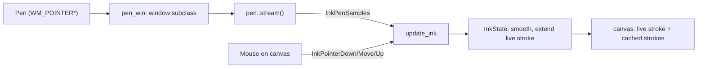

# Handwritten Notes

A pressure-sensitive ink canvas in its own window, so it can sit on a tablet or second
monitor beside the notes. Pages are saved into the vault as `.ink` files.

**Platform support.** Pen pressure is captured on Windows only (`ink/pen_win.rs`); iced
drops pressure when it converts pointer events, so the app reads the Win32 pointer stack
directly. Everywhere else the canvas works with a mouse at a fixed pressure.

| Piece | Where | Owns |
| :--- | :--- | :--- |
| State | `native/src/ink/mod.rs` → `InkState` | Document, tool and colour settings, camera, live stroke, lasso selection, radial menu; pen input and the stroke lifecycle in `ink/input.rs` |
| Geometry | `ink/stroke.rs` | Input smoothing and pressure → filled outline. No iced or platform types |
| Document | `ink/document.rs` | Strokes, undo/redo, paper style, the JSON file format |
| Camera | `ink/camera.rs` | Page ⇄ screen mapping for pan and zoom |
| Canvas | `ink/canvas.rs` | The iced canvas: a retained cache for finished strokes, the live stroke redrawn per frame |
| Pen input | `ink/pen.rs`, `ink/pen_win.rs` | Sample type and the stream into iced; the Windows capture hook |
| Radial menu | `ink/radial.rs` | The ring summoned at the nib with the pen's barrel button |
| Chrome | `native/src/views/ink.rs` | Toolbar and colour palette |
| Messages | `native/src/app/ink.rs` → `update_ink` | Every `Ink*` message; opening, closing and saving pages |

---

## 1. Using It

- `Ctrl+I` (or *Handwriting Canvas* in the palette) opens or closes the window. Opening a
  `.ink` file from the sidebar or a link opens it in the same window.
- **Tools** — pen, highlighter (translucent, drawn behind writing), eraser (partial: rubs
  out only what is under the tip; or whole-stroke), and lasso (circle strokes, then drag to
  move or `Delete` to remove).
- **Paper** — plain, ruled, grid, or dotted (the default).
- **Radial menu** — press the pen's barrel button: tools on the inner ring, colours on the
  outer one; the centre cancels.
- `Ctrl+Z` / `Ctrl+Y` undo and redo on the canvas, `Ctrl+S` saves the page while the canvas
  is in front, and `Escape` clears a lasso selection.
- Writing near the bottom edge scrolls the page up, so a sentence never runs out of room.

Pages are **not autosaved**. Closing the window keeps the page in memory for the session,
but unsaved strokes are lost when the app exits.

## 2. Saving and the File Format

`Ctrl+S` writes the page to its existing path, or on first save derives one
(`app/ink.rs::derive_ink_path`):

- beside the open note, with its extension replaced — `notes/lecture.md` →
  `notes/lecture.ink`;
- otherwise at the vault root as `handwritten-<YYYYMMDD-HHMMSS>.ink`.

`ink::save_to_vault` writes through the vault's atomic writer but deliberately skips
`vault::save_file`, which would add stroke coordinates to the full-text index.

The file is JSON with a `version` field (`FORMAT_VERSION = 1`). Strokes are stored as the
**sampled pen path** (position and pressure per sample), not the rendered outline: the
outline is recomputed from the path and the current `StrokeOptions`, so a page re-renders
crisply at any zoom and survives retuned smoothing.

## 3. Input Pipeline

- The Win32 hook is attached to whichever window holds the canvas, and re-attached each
  time it is reopened (`WindowOpened` → `InkPenHookReady` with the raw window id).
- The pen stream is always subscribed: it consumes a process-wide receiver, so tearing it
  down would leave a second subscription with nothing to read. It is silent unless the ink
  window has claimed pen capture.
- Pen samples arrive in physical pixels; the ink window's own scale factor converts them,
  since the two windows can sit on monitors with different scaling.

## 4. Rendering

Each stroke becomes a filled polygon that widens and narrows with pressure
(`stroke.rs`), because a plain polyline has one uniform width. Finished strokes are drawn
into a retained `canvas::Cache` rebuilt only when the document or camera changes; only the
stroke under the pen is re-tessellated each frame, which keeps writing smooth on long
pages.

## 5. Tests

`ink/tests.rs` (state and tools), `ink/document/tests.rs` (undo/redo, erasing, the file
format) and `ink/stroke/tests.rs` (smoothing and outlines) run on every platform; the
Windows capture layer has no automated tests.
