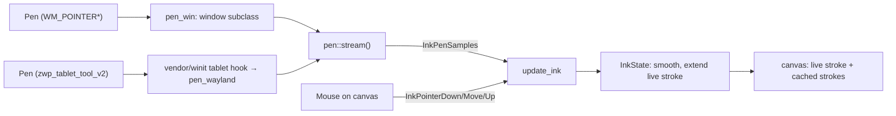

# Handwritten Notes

A pressure-sensitive ink canvas in its own window, so it can sit on a tablet or second
monitor beside the notes. Pages are saved into the vault as `.ink` files.

**Platform support.** iced drops pressure when it converts pointer events, so the app
captures the pen below it:

- **Windows** — the Win32 pointer stack (`ink/pen_win.rs`).
- **Linux, Wayland** — the tablet protocol `zwp_tablet_v2` (`ink/pen_wayland.rs`), through
  a tablet hook in the vendored winit (`vendor/winit`, applied with `[patch.crates-io]`;
  the change is `vendor/winit/md-editor-patches/`). This needs a compositor that
  offers the protocol (Hyprland, GNOME, KDE and sway all do).
- **Elsewhere** (X11, macOS) — the canvas works with a mouse at a fixed pressure.

The log says `Pen input ready` when capture is installed, or `Pen input unavailable: …`
and why when it isn't.

| Piece | Where | Owns |
| :--- | :--- | :--- |
| State | `native/src/ink/mod.rs` → `InkState` | Document, tool and colour settings, camera, live stroke, lasso selection, radial menu; pen input and the stroke lifecycle in `ink/input.rs` |
| Geometry | `ink/stroke.rs` | Input smoothing and pressure → filled outline. No iced or platform types |
| Document | `ink/document.rs` | Strokes, undo/redo, paper style, the JSON file format |
| Camera | `ink/camera.rs` | Page ⇄ screen mapping for pan and zoom |
| Canvas | `ink/canvas.rs` | The iced canvas: a retained cache for finished strokes, the live stroke redrawn per frame |
| Pen input | `ink/pen.rs`, `ink/pen_win.rs`, `ink/pen_wayland.rs` | Sample type and the stream into iced; the Windows and Wayland capture hooks |
| Radial menu | `ink/radial.rs` | The ring summoned at the nib with the pen's upper side button |
| Chrome | `native/src/views/ink.rs` | Toolbar and colour palette |
| Messages | `native/src/app/ink.rs` → `update_ink` | Every `Ink*` message; opening, closing and saving pages |

---

## 1. Using It

- `Ctrl+I` (or *Handwriting Canvas* in the palette) opens or closes the window. Opening a
  `.ink` file from the sidebar or a link opens it in the same window.
- **Tools** — pen, highlighter (translucent, drawn behind writing), eraser (partial: rubs
  out only what is under the tip; or whole-stroke), and lasso (circle strokes, then drag to
  move or `Delete` to remove).
- **Paper** — plain, ruled, grid, or dotted (the default).
- **Pen buttons** — the eraser end, or holding the lower side button, erases whatever tool
  is selected (the eraser ring shows while hovering). The upper side button opens the
  **radial menu**: tools on the inner ring, colours on the outer one; the centre cancels.
  On Wayland the mapping is in `ink/pen_wayland.rs::sample_for`; Windows reports a single
  barrel button, which opens the menu.
- `Ctrl+Z` / `Ctrl+Y` undo and redo on the canvas, `Ctrl+S` saves the page while the canvas
  is in front, and `Escape` clears a lasso selection.
- Finishing a stroke near the bottom edge scrolls the page up, so the next line has room.
  The page never moves while the pen is down: that would slide the page under a nib that
  stays put and smear the stroke (`ink/input.rs::advance_if_near_bottom`).

**Sketches in notes.** `Ctrl+Shift+I` (*Insert Sketch* in the palette) in a note creates
an empty page beside it, `notes/lecture-sketch.ink` (then `-sketch-2`, …), inserts
`` at the caret, and opens the page in the ink window
(`app/ink.rs::insert_sketch`). Any `.ink` page linked as an image shows in the note,
cropped to its ink. The note's picture follows the drawing each time the page autosaves,
and `Ctrl` + click on it opens the page to edit.

Pages **autosave** one second after a change (`INK_AUTOSAVE_DELAY`, never mid-stroke), and
are also written when the ink window closes, when the app quits, and before another page
replaces the one on the canvas. A page is only replaced once it is safely on disk.

## 2. Saving and the File Format

A save writes the page to its existing path, or on first save derives one
(`app/ink.rs::derive_ink_path`), taking the first free `-2`, `-3`, … suffix
(`unique_ink_path`) so a note's existing page is never overwritten:

- beside the open note, with its extension replaced — `notes/lecture.md` →
  `notes/lecture.ink`;
- otherwise at the vault root as `handwritten-<YYYYMMDD-HHMMSS>.ink`.

`ink::save_to_vault` writes through the vault's atomic writer but deliberately skips
`vault::save_file`, which would add stroke coordinates to the full-text index.

The file is JSON with a `version` field (`FORMAT_VERSION = 1`). Strokes are stored as the
**sampled pen path** (position and pressure per sample), not the rendered outline: the
outline is recomputed from the path and the current `StrokeOptions`, so a page re-renders
crisply at any zoom and survives retuned smoothing.

## 3. Input Pipeline

- The Win32 hook is attached to whichever window holds the canvas, and re-attached each
  time it is reopened (`WindowOpened` → `InkPenHookReady` with the raw window id).
- On Wayland, binding the tablet protocol stops the compositor from emulating a mouse for
  the pen. winit offers each tool frame to `pen_wayland` first. Frames on the canvas are
  claimed (`pen_wayland::Router`, the same rules as `pen_win`: a stroke that starts on the
  canvas owns the pen until it lifts, and hover over the canvas hides the system cursor).
  winit turns every unclaimed frame back into cursor and left-button events, so the pen
  still presses toolbar buttons and works in the main window. Window decorations are left
  to the compositor.
- The pen stream is always subscribed: it consumes a process-wide receiver, so tearing it
  down would leave a second subscription with nothing to read. It is silent unless the ink
  window has claimed pen capture.
- Pen samples arrive in physical pixels; the ink window's own scale factor converts them,
  since the two windows can sit on monitors with different scaling.

## 4. Rendering

Each stroke becomes a filled polygon that widens and narrows with pressure
(`stroke.rs`), because a plain polyline has one uniform width. Finished strokes are drawn
into a retained `canvas::Cache` rebuilt only when the document or camera changes; only the
stroke under the pen is re-tessellated each frame, which keeps writing smooth on long
pages.

A page shown in a note is rasterized by `ink/raster.rs::render` (through `raster::decode`,
like any image). It traces the same outlines with tiny-skia on a transparent ground,
highlighter under pen, cropped to the ink plus a 16 px margin at 2× density. A changed page
is decoded again (`EditorPane::refresh_changed_files`) while the old picture stays up, so a
note does not flicker as its sketch autosaves.

## 5. Tests

`ink/tests.rs` (state and tools), `ink/document/tests.rs` (undo/redo, erasing, the file
format) and `ink/stroke/tests.rs` (smoothing and outlines) run on every platform; the
Windows capture layer has no automated tests.
