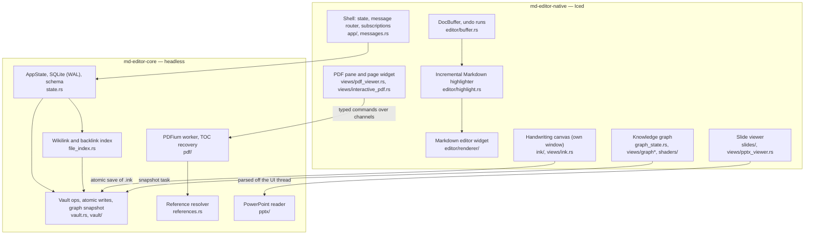

# MD Editor Wiki

**MD Editor** is a calm, native, local-first desktop workspace for Markdown notes, PDFs,
presentations, images, a knowledge graph, handwritten notes, search, backlinks, and study
progress. It is written in Rust on [Iced](https://github.com/iced-rs/iced) 0.14 and Google's
[PDFium](https://pdfium.googlesource.com/pdfium/).

This wiki is the authoritative documentation. If a page and the code disagree, the code is
right and the page is a bug.

---

## I want to change…

| …this | Start here | Then read |
| :--- | :--- | :--- |
| How Markdown looks or edits | `native/src/editor/` | [Markdown Pipeline](Markdown-Pipeline.md) |
| What a message or shortcut does | `native/src/app/<family>.rs` | [Native Desktop GUI](Native-Desktop-GUI.md#2-messages-and-where-they-are-handled-messagesrs-app), [Keyboard Shortcuts](Keyboard-Shortcuts.md) |
| Saving, opening, file operations | `native/src/app/documents.rs`, `core/src/vault.rs` | [Data Flows & Invariants](Data-Flows-and-Durability-Invariants.md), [Core Services](Core-Services.md) |
| PDF rendering, TOC, references | `core/src/pdf/`, `core/src/references.rs` | [PDF Engine & Sidecars](PDF-Engine-and-Sidecars.md) |
| The PDF pane, highlights, linked notes | `native/src/app/pdf*.rs`, `native/src/views/pdf_viewer.rs` | [PDF Viewer Internals](PDF-Viewer-Internals.md) |
| Presentations | `core/src/pptx/`, `native/src/slides/` | [Core Services §8](Core-Services.md#8-powerpoint-presentations-pptxrs-pptx) |
| The knowledge graph | `native/src/graph_state.rs`, `native/src/views/graph*` | [Knowledge Graph](Knowledge-Graph.md) |
| Handwriting | `native/src/ink/` | [Handwritten Notes](Handwritten-Notes.md) |
| Search, wikilinks, backlinks | `core/src/file_index.rs`, `native/src/app/search.rs` | [Core Services](Core-Services.md) |
| The study tracker | `native/src/views/tracker.rs`, `core/src/tracker.rs` | [Study Tracker](Study-Tracker.md) |
| Colours, spacing, animation | `native/src/theme.rs`, `native/src/motion.rs` | [Design Tokens & Motion](Design-Tokens-Motion-and-Palette.md) |
| The database schema | `core/src/state.rs` | [Core Services](Core-Services.md) |

Every source file opens with a one-line `//!` summary: `grep -rm1 '^//!' core/src native/src`
prints a map of the code. [Repository Structure](Repository-Structure.md) has the same map
with more detail.

---

## Architecture at a Glance

Two crates: a headless engine (`md-editor-core`) and the desktop app (`md-editor-native`).

---

## Pages

| Page | Covers |
| :--- | :--- |
| [User Guide & Feature Manual](User-Guide-and-Feature-Manual.md) | Everything a user can do |
| [Keyboard Shortcuts](Keyboard-Shortcuts.md) | Every binding, and which layer owns it |
| [Architecture & Philosophy](Architecture-and-Philosophy.md) | Local-first, durability, non-destructive sidecars, threading |
| [Repository Structure](Repository-Structure.md) | Crates and per-file responsibilities |
| [Data Flows & Durability Invariants](Data-Flows-and-Durability-Invariants.md) | Keystroke to atomic save, navigation, highlight creation |
| [Core Services](Core-Services.md) | SQLite schema, paths, vault operations, wikilinks, search, presentations |
| [Native Desktop GUI](Native-Desktop-GUI.md) | Lifecycle, windows, message routing, sub-states, subscriptions, views |
| [Markdown Pipeline](Markdown-Pipeline.md) | Buffer, incremental highlighting, rhythm, caret, drawing |
| [PDF Engine & Sidecars](PDF-Engine-and-Sidecars.md) | PDFium worker, TOC recovery, references, annotations |
| [PDF Viewer Internals](PDF-Viewer-Internals.md) | PDF pane state, generations, navigation, zoom |
| [Knowledge Graph](Knowledge-Graph.md) | Snapshot, refresh, layout, simulation, GPU rendering, insights |
| [Handwritten Notes](Handwritten-Notes.md) | Ink window, pen capture, strokes, the `.ink` format |
| [Design Tokens & Motion](Design-Tokens-Motion-and-Palette.md) | Type scale, spacing, colours, easing, springs |
| [Study Tracker](Study-Tracker.md) | Timer, sessions, curriculum config, storage |
| [Developer Guide & Testing](Developer-Guide-and-Testing.md) | Toolchain, builds, PDFium, test suites |
| [Release Checklist](Release-Checklist.md) | Pre-release verification and packaging |
| [Contributor Guidelines](Contributor-Guidelines.md) | Architectural rules and PR checklist |

New contributors: read [Contributor Guidelines](Contributor-Guidelines.md), then
[Developer Guide & Testing](Developer-Guide-and-Testing.md), then
[Data Flows & Durability Invariants](Data-Flows-and-Durability-Invariants.md).

**The Field Handbook** — a ~100-page printable tour of the codebase lives at
[`docs/MD-Editor-Handbook.pdf`](../docs/MD-Editor-Handbook.pdf). It is a snapshot from
2026-09-14 and predates the knowledge graph, handwriting and the module splits; this wiki is
current.

---

## Conventions for These Pages

- Name the file (and function) a claim comes from, so it can be checked. Prefer symbol
  names over line numbers, which rot on every edit.
- Do not copy lists the code already holds (every `Message` variant, every constant);
  link to the file and describe the shape instead.
- When code moves, update [Repository Structure](Repository-Structure.md) and the
  "I want to change…" table above in the same change.
