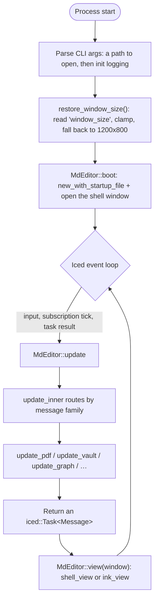
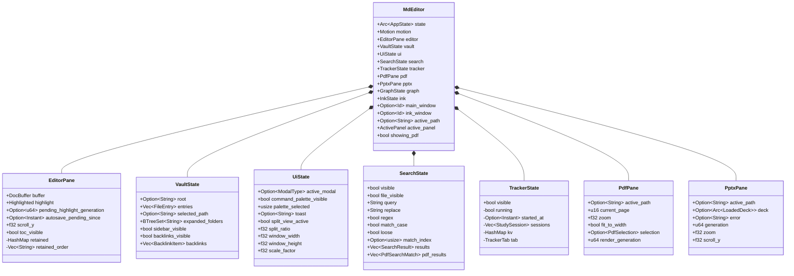

# Native Desktop GUI (`md-editor-native`)

`md-editor-native` implements the graphical shell. It is built on [Iced](https://github.com/iced-rs/iced)
0.14, using custom `Widget` implementations for the markdown editor and PDF pages, async
work through `iced::Task` on a Tokio runtime, and subscriptions that are armed only when
they have something to do.

---

## 1. Application Lifecycle (`main.rs`, `app/mod.rs`)

The app runs as an iced **daemon** rather than a single-window application, because the
handwriting canvas lives in a window of its own. A daemon starts with no windows, so
`MdEditor::boot` opens the shell window itself:

```rust
iced::daemon(
    move || app::MdEditor::boot(main_window.clone(), startup_path.clone()),
    app::MdEditor::update,
    app::MdEditor::view,          // view(&self, window::Id)
)
.title(app::MdEditor::title)      // title(&self, window::Id)
.theme(|state: &app::MdEditor, _window| state.theme())
.subscription(app::MdEditor::subscription)
.run()
```



**Windows.** `main_window` is the shell; closing it exits the process (`WindowClosed`).
`ink_window` exists only while the handwriting canvas is open (`Ctrl+I`). Window events
carry their `window::Id`, so resizes and DPI changes of the ink window never touch the
shell's saved geometry or PDF supersampling.

**A structural rule:** a sub-state's own `update` handles only messages that touch its own
fields. Anything cross-cutting — a modal submit that creates a vault entry, opening a file,
computing backlinks — stays on the shell, which alone owns the shared `Arc<AppState>`.

---

## 2. Messages and Where They Are Handled (`messages.rs`, `app/`)

`Message` (in `messages.rs`) has one variant per feature family, each wrapping that
family's own enum. `MdEditor::update_inner` is an exhaustive match that hands the
inner enum to the family's handler, and every handler matches its enum **exhaustively** —
there is no `_ => Task::none()` catch-all, so a message that is added but not handled is a
compile error rather than a silently dropped event. To find the code for a message, find
its family:

| Message | Handler | File |
| :--- | :--- | :--- |
| `Message::Pdf(PdfMessage)` | `update_pdf` | `app/pdf.rs` routes to `pdf_render.rs`, `pdf_nav.rs`, `pdf_select.rs` (page management in `app/pdf_pages.rs`) |
| `Message::Graph(GraphMessage)` | `update_graph` | `app/graph.rs` |
| `Message::Ink(InkMessage)` | `update_ink` | `app/ink.rs` |
| `Message::Search(SearchMessage)` — global search and find/replace | `update_search` | `app/search.rs` |
| `Message::Editor(EditorMessage)` — editing, autosave, animation ticks, math, outline | `update_editor` | `app/editor.rs` |
| `Message::Vault(VaultMessage)` — vault lifecycle, file tree, create/rename/delete and name modals, the link-note picker | `update_vault` | `app/vault.rs` |
| `Message::Tabs(TabsMessage)` — the document tab strip | `update_tabs` | `app/tabs_handler.rs` |
| `Message::Settings(SettingsMessage)` — the Settings page | `update_settings` | `app/settings_handler.rs` |
| `Message::KeyboardShortcut(Shortcut)` | `update_shortcuts` | `app/shortcuts.rs` |
| `Message::Shell(ShellMessage)` — windows, split view, command palette, toasts, study tracker, presentations | `update_shell` | `app/shell.rs` |

Construct a message as `Message::Pdf(PdfMessage::FitToWidth)`, or `PdfMessage::FitToWidth.into()`
where the target type is known. Sub-states (`UiState`, `TrackerState`, `PdfPane`, …) still
take the whole `Message` and keep catch-alls; moving them onto family enums is code-health
W7.

The rest of `app/` holds the shared machinery: `documents.rs` (opening, saving, parking
documents and persisting the session), `subscription.rs`, `view.rs` (the shell layout),
`overlays.rs` (palette, search, dialogs, context menus, toasts), `links.rs` (wikilink and
heading resolution) and `tests.rs`.

After every message, `MdEditor::update` hands the keyboard back to the note when an
overlay with a text field closes (palette, find, vault search, a dialog) or `F6` lands on
the main region, through the editor widget's `operate` (it is `Focusable` under
`editor::renderer::EDITOR_ID`).

`Shortcut` is the indirection that lets the keyboard subscription and the command palette
trigger exactly the same handler. Adding a message means: a variant in the family enum in
`messages.rs` and an arm in that family's handler — the compiler points at the handler if
you forget.

---

## 3. Sub-State Separation

Rather than one monolithic struct, `MdEditor` composes domain sub-states, each owning its
own fields and the messages that touch only those fields.



- **`EditorPane`** (`editor_state.rs`) — the active `DocBuffer`, its `Highlighted` lines
  (updated incrementally and synchronously on every edit), the image and math caches, the
  autosave timestamp, scroll offset, the pending caret-reveal request, TOC visibility, and
  the retained-buffer registry capped at `MAX_RETAINED_BUFFERS = 32`. `layout_revision()`
  names what the editor widget lays out, so it can skip layout on frames where nothing
  changed. It also defines the timing constants `AUTOSAVE_DEBOUNCE = 400ms` and
  `AUTOSAVE_POLL = 100ms`.
- **`VaultState`** (`vault_state.rs`) — vault root, file entries, sidebar selection and
  expansion, and the backlinks panel. Note that `active_path` deliberately stays on the
  shell: it is a cross-cutting "current document" shared by the editor, search, and PDF.
- **`UiState`** (`ui_state.rs`) — modals, the command palette and its highlighted row, the
  toast, split-view state and divider ratio, window size, and the display scale factor that
  drives PDF supersampling.
- **`SearchState`** (`search_state.rs`) — query and replacement text, the `regex`,
  `match_case`, and PDF-only `loose` flags, vault and PDF results, and a memoized
  in-document match cache keyed by `DocMatchKey` so `view` never rescans the buffer.
  `SEARCH_DEBOUNCE = 200ms`.
- **`TrackerState`** (`tracker_state.rs`) — timer state, loaded sessions, tracker
  key-values, active tab, and the JSON config editor content.
- **`PdfPane`** (`pdf_pane.rs`) — the PDF viewport, page caches, annotations, selection, and
  the render generation. Documented in detail in
  [PDF Viewer Internals](PDF-Viewer-Internals.md).
- **`GraphState`** (`graph_state.rs`) — the knowledge graph: the latest `GraphSnapshot`,
  scope and filters, selection and pins, the view transform, and the force simulation. See
  [Knowledge Graph](Knowledge-Graph.md).
- **`InkState`** (`ink/mod.rs`) — the handwriting surface: the open `.ink` document and its
  path, tool and colour settings, the camera, the in-progress stroke, and selection. See
  [Handwritten Notes](Handwritten-Notes.md).
- **`PptxPane`** (`pptx_pane.rs`) — the open presentation: the prepared `LoadedDeck`, the
  load `generation` (bumped by every load and by closing, so the result of a slow parse the
  reader has since left is dropped when it lands), the error to show, zoom as a multiple of
  fit-to-width, and the scroll position the slide counter and slide stepping are derived
  from. A reload triggered by the vault watcher keeps the old deck on screen until the new
  one is ready, and a reload that fails keeps it rather than flashing an error.

---

## 4. Reactive Subscriptions (`app/subscription.rs`)

Every stream except the keyboard, window events, the vault watcher and pen input returns
`Subscription::none()` when it has nothing to do:

1. **Keyboard** — `iced::event::listen_with` filters key presses and returns `None` for
   anything the app does not act on, so ordinary typing (handled by the focused editor
   widget) does not spawn a redundant update cycle. See [Keyboard Shortcuts](Keyboard-Shortcuts.md).
2. **Toast timeout** — armed only while `ui.toast` is set; fires `ToastHide` after 3s.
3. **Autosave poll** — armed only while `editor.autosave_pending_since` is set; ticks every
   `AUTOSAVE_POLL` (100ms) and writes once `AUTOSAVE_DEBOUNCE` (400ms) has elapsed since the
   last keystroke. The poll is deliberately finer than the debounce because its phase is
   independent of when the user stopped typing.
4. **Search debounce** — armed only while a query keystroke is pending; ticks every
   `SEARCH_DEBOUNCE` (200ms), so a ten-character query runs one FTS/PDF scan rather than ten.
5. **Filesystem watcher** — a `notify` recursive watch on the vault, debounced by
   `VAULT_WATCH_DEBOUNCE = 300ms`, emitting `VaultFilesChanged` with the changed paths. A
   `SELF_WRITE_GRACE` of 3s suppresses events caused by the app's own saves. External edits
   (`git pull`, a CLI change) refresh buffers and the link index without a restart.
6. **Scroll interrupt** — armed only while the editor is gliding to reveal the caret; a
   wheel turn or click fires `EditorScrollInterrupted` and hands the page back to the user.
   See [Markdown Pipeline](Markdown-Pipeline.md#revealing-the-caret).

7. **Graph refresh and physics** — armed only while the graph is visible: a 200ms refresh
   while the snapshot is stale, and a 33ms physics tick while the simulation runs.
8. **Pen input** — always on (the stream owns a process-wide receiver); it yields nothing
   unless the ink window has claimed pen capture.

Animation frames are armed the same way, from `motion.is_animating()`; see
[Design System & Motion](Design-Tokens-Motion-and-Palette.md).

---

## 5. View Layer Components (`views/`)

Every view is built from the shared components in `ui/` and the tokens in `design/`; see
[Design System & Motion](Design-Tokens-Motion-and-Palette.md). The shell (`app/view.rs`) is
toolbar, tab strip, sidebar, main pane, side panel and status bar, with `SplitHandle`s
between panes; `ui::context_anchor` wraps the window so a right click opens its menu at the
pointer.

- **Toolbar** (`toolbar.rs`) — sidebar toggle, breadcrumb path with the save state
  (Saved · Saving · Unsaved · Save failed), then grouped `IconButton`s for search, palette,
  split view, outline, backlinks, graph, handwriting, tracker and Settings.
- **Tab strip** (`ui::tab_strip`, state in `tabs.rs`) — one tab per open document, with a
  dirty dot, a missing badge, drag to reorder, middle-click to close, a right-click menu and
  an overflow list.
- **Sidebar** (`sidebar.rs`) — a `Panel` with a filter field and the file tree of
  `TreeRow`s (indent guides, file-type icons, ellipsis with tooltip). Selecting a row shows
  rename and delete; right-click opens the file menu. New entries go into the selected
  folder, or beside the selected file, only while that row is visible in the tree;
  otherwise into the vault root.
- **Status bar** (`ui::status_bar`) — save state, line and column, words, selection, indexing
  and the vault's name; hidden in focus mode.
- **Settings** (`settings.rs`) — Appearance, Editor, Files, Keyboard and About.
- **Command palette** (`command_palette.rs`) — the `Ctrl+P` overlay; commands come from the
  shortcut registry (`shortcuts.rs`) and interleave with vault files, capped at
  `MAX_RESULTS = 40`.
- **Viewer toolbar** (`viewer_toolbar.rs`) — shared by PDFs, presentations and images:
  outline, an editable page (or slide) field, zoom steps and an editable zoom field, fit
  width / fit page, find, plus the view's own tools in the middle.
- **PDF viewer** (`pdf_viewer.rs`) and **interactive PDF** (`interactive_pdf.rs`) — the
  toolbar (highlight swatches from the content palette when text is selected, the focused
  highlight's actions), the find bar, and the continuous page list on the viewer ground,
  with page-sized placeholders while pages render; page bitmaps wrapped in a custom `Widget`
  for hit testing and drag selection, and canvas overlays for annotations, focus outlines,
  search matches, the live selection, and reference underlines.
- **Presentation viewer** (`pptx_viewer.rs`, with `slides/`) — every slide in one scrolling
  column under its number and title. A deck is parsed and all its text laid out once, off
  the UI thread (`slides::load_deck`), in points, so zooming and resizing never lay text out
  again. Each slide is a `stack` of canvases, one per layer from `slides::layer_ranges`.
- **Knowledge graph** (`graph.rs`, `graph/`, `gpu_graph.rs`) — a GPU canvas for nodes and
  edges with a label overlay, a toolbar of `Segmented` scope and depth, search and filter
  chips, a legend card and viewport controls over the canvas, and an inspector `Panel`. See
  [Knowledge Graph](Knowledge-Graph.md).
- **Handwriting chrome** (`ink.rs`) — the ink window's toolbar (tools, widths, paper,
  zoom, unsaved chip, Save) and colour rail; the canvas itself is `ink/canvas.rs`. See
  [Handwritten Notes](Handwritten-Notes.md).
- **Backlinks** (`backlinks.rs`) and **Outline** (`toc.rs`) — right-hand `Panel`s; the outline
  marks the current heading.
- **Search** (`search.rs`) — the in-note find bar with its replace row, and the vault search
  overlay.
- **Toasts** (`toast.rs`) — a queue of up to three; errors persist and can carry Retry.
- **Modals** (`modals.rs`) and **link note picker** (`link_note_picker.rs`) — every dialog on
  `ui::dialog`, with inline validation.
- **Tracker** (`tracker.rs`, `tracker/`) — a main-area view: header with the single
  Start/Stop timer action, underline tabs, stat cards, a 14-day bar chart, and the tab
  bodies in `tracker/sections.rs`; the JSON schema is `tracker/config.rs`.
- **Welcome** (`welcome.rs`) — the zero-state: app mark, *Open folder…*, *Create vault…*,
  recent vaults and shortcut hints.
